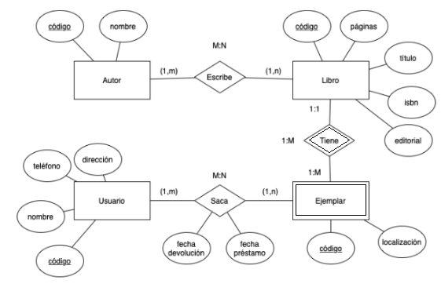
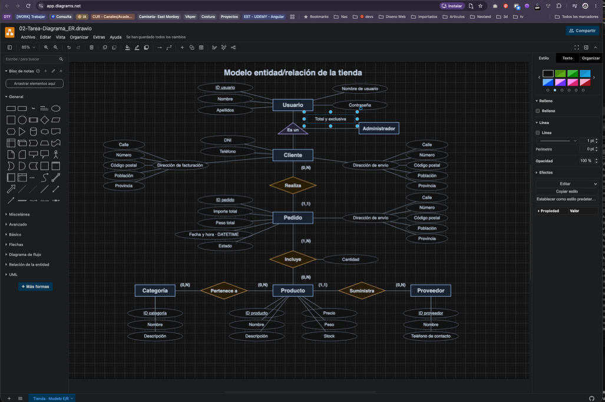
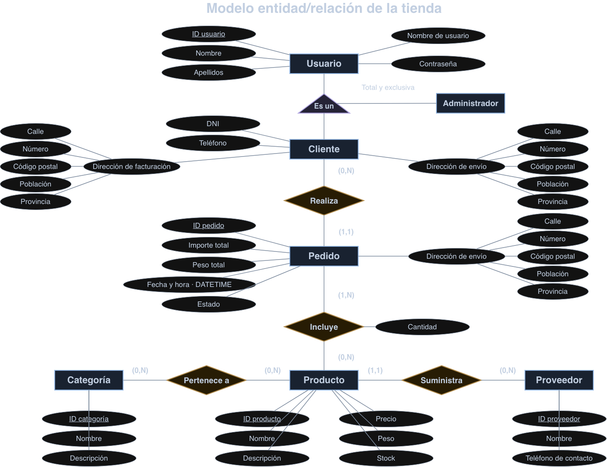
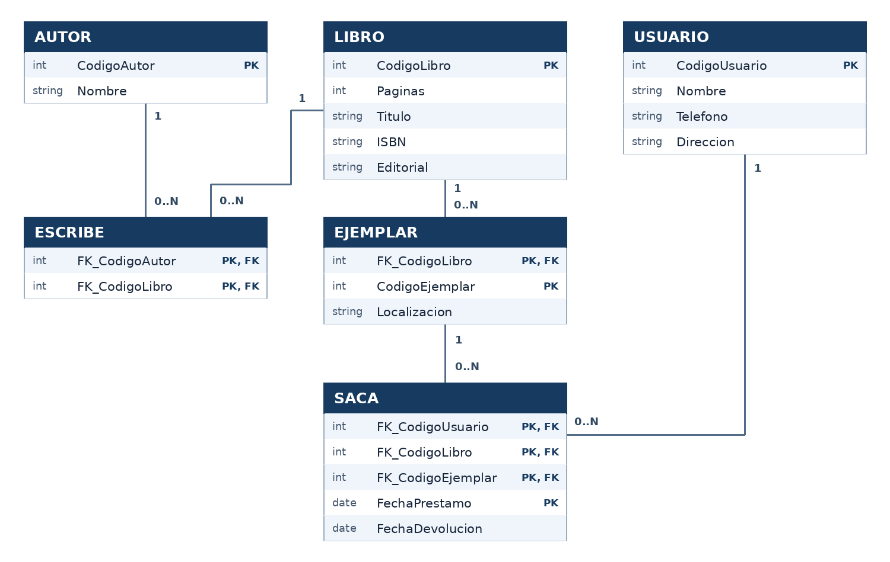

# Modelo E/R y modelo relacional

**Bases de Datos · UD2 · Tarea 1**  
**Autor:** Iván Villarrubia Moreno

## Índice

- [Enunciado](#enunciado)
- [Introducción](#introducción)
- [1. Modelo entidad/relación de la tienda](#1-modelo-entidadrelación-de-la-tienda)
  - [Entidades y atributos](#entidades-y-atributos)
  - [Diagrama entidad/relación](#diagrama-entidadrelación)
- [2. Modelo relacional de la biblioteca](#2-modelo-relacional-de-la-biblioteca)
  - [Tablas resultantes y claves](#tablas-resultantes-y-claves)
  - [Diagrama relacional y descripción](#diagrama-relacional-y-descripción)
- [Conclusión](#conclusión)
- [Bibliografía y recursos](#bibliografía-y-recursos)

## Enunciado

En tu tarea diaria como profesional en bases de datos tendrás que hacer diagramas E/R que te ayudarán a diseñar las distintas bases de datos que te soliciten.

**1. Tienda.** Realizar un diagrama con las entidades, atributos, relaciones y cardinalidades según estas especificaciones.

- En el sistema tendremos dos tipos de usuarios: clientes y administradores.
- De todos los usuarios se desea almacenar el código identificador (ID), nombre, apellidos, nombre de usuario y contraseña.
- De cada cliente, se almacenará, además, el DNI, dirección de facturación, dirección de envío y teléfono. Los clientes podrán realizar pedidos en la tienda.
- De cada pedido se almacenará el ID, importe total, dirección de envío, el peso total, la fecha y hora del pedido (un único atributo DATETIME), el estado en el que se encuentra y la cantidad de cada producto que incluye. Un pedido puede estar en tres estados (Recibido, En preparación y Enviado).
- De cada producto, se almacenará el ID, nombre, descripción, precio, peso y stock.
- Los productos se organizan por categorías, donde un producto puede pertenecer a varias y en una categoría puede haber varios productos. Cada categoría tiene un ID, nombre y descripción.
- Se necesita también almacenar la información de los proveedores de cada producto. De cada proveedor se almacenará el ID, Nombre y teléfono de contacto. Un producto solo puede tener un proveedor, pero un proveedor puede suministrar varios productos.
- De todas las direcciones se almacenará información sobre la calle, número, cp, población y provincia.

Herramientas propuestas: [diagrams.net](https://app.diagrams.net/), [Dia](http://diainstaller.de/download/index.html) o MySQL Workbench.

**2. Biblioteca.** La empresa se plantea prestar libros además de venderlos. A partir del siguiente diagrama entidad/relación, hay que identificar las tablas y sus columnas.

- Escribir una línea por tabla con el nombre y las columnas entre paréntesis.
- Subrayar la clave primaria y, si es compuesta, todas las columnas que la forman.
- Añadir el prefijo `FK_` a las columnas que sean claves foráneas.

## Introducción

En esta tarea se trabajan dos etapas del diseño de una base de datos. En el primer apartado se representa una tienda mediante un diagrama entidad/relación, en el que se identifican las entidades, sus atributos y cómo se relacionan. En el segundo apartado se parte del diagrama de una biblioteca y se transforma en un modelo relacional, indicando las tablas, sus columnas y las claves primarias y foráneas.

## 1. Modelo entidad/relación de la tienda

### Entidades y atributos

| Entidad | Atributos |
|---|---|
| Usuario | ID_usuario, nombre, apellidos, nombre de usuario y contraseña. |
| Cliente | Hereda el ID_usuario y los demás datos de Usuario. Añade DNI, dirección de facturación, dirección de envío y teléfono. |
| Administrador | Hereda el ID_usuario y los demás datos de Usuario. El enunciado no le asigna atributos propios. |
| Pedido | ID_pedido, importe total, dirección de envío, peso total, fecha y hora (`DATETIME`) y estado. |
| Producto | ID_producto, nombre, descripción, precio, peso y stock. |
| Categoría | ID_categoria, nombre y descripción. |
| Proveedor | ID_proveedor, nombre y teléfono de contacto. |

### Diagrama entidad/relación

*Captura del programa utilizado para preparar el diagrama.*

**Estado del pedido:** Recibido, En preparación y Enviado.

- [Diagrama editable en GitHub](https://github.com/soyHiwan/DAM-Cesur/blob/main/BBDD/02-Tarea-Diagrama_ER.drawio)
- [Diagrama en Google Drive](https://drive.google.com/file/d/1i9MUzKSgcDwx70pOH7hYW_-YBqFlTTIj/view?usp=drive_link)

## 2. Modelo relacional de la biblioteca

### Tablas resultantes y claves

Las claves primarias están subrayadas. El prefijo `FK_` identifica las columnas que forman claves foráneas.

**AUTOR** (<ins>CodigoAutor</ins>, Nombre)  
**LIBRO** (<ins>CodigoLibro</ins>, Paginas, Titulo, ISBN, Editorial)  
**USUARIO** (<ins>CodigoUsuario</ins>, Nombre, Telefono, Direccion)  
**EJEMPLAR** (<ins>FK_CodigoLibro</ins>, <ins>CodigoEjemplar</ins>, Localizacion)  
**ESCRIBE** (<ins>FK_CodigoAutor</ins>, <ins>FK_CodigoLibro</ins>)  
**SACA** (<ins>FK_CodigoUsuario</ins>, <ins>FK_CodigoLibro</ins>, <ins>FK_CodigoEjemplar</ins>, <ins>FechaPrestamo</ins>, FechaDevolucion)

`FechaPrestamo` forma parte de la clave para que el mismo usuario pueda volver a pedir el mismo ejemplar en otra fecha. Para cumplir el mínimo del diagrama original, al completar el alta de un libro se debe comprobar que tenga al menos un autor asociado. Una clave foránea por sí sola no garantiza ese mínimo.

### Diagrama relacional y descripción

El modelo relacional de la biblioteca está formado por seis tablas. AUTOR, LIBRO, USUARIO y EJEMPLAR guardan los datos principales. ESCRIBE y SACA registran las relaciones entre ellos.

- **AUTOR** guarda el código y el nombre de cada autor. El código permite distinguir a dos autores que tengan el mismo nombre.

- **LIBRO** guarda el código, el título, el número de páginas, el ISBN y la editorial. Cada fila describe un libro del catálogo, del que puede haber varias copias.

- **USUARIO** guarda el código, el nombre, el teléfono y la dirección de cada persona que puede pedir libros prestados.

- **EJEMPLAR** representa una copia física de un libro y guarda su localización. Su clave primaria combina el código del libro y el código del ejemplar. Así, dos libros distintos pueden tener un ejemplar con el número 1.

- **ESCRIBE** une autores y libros. Cada fila indica que un autor ha participado en un libro. Como un autor puede escribir varios libros y un libro puede tener varios autores, la tabla guarda ambos códigos y los usa juntos como clave primaria.

- **SACA** registra los préstamos. Cada fila indica qué usuario se llevó qué ejemplar, en qué fecha y cuándo lo devolvió. Para identificar la copia se necesitan juntos el código del libro y el del ejemplar. En este diseño, la fecha de préstamo también forma parte de la clave primaria para que un usuario pueda llevarse la misma copia en fechas distintas.

En el diagrama, PK señala las columnas que forman la clave primaria, que identifica cada fila. FK señala las columnas que forman una clave foránea, que enlaza con otra tabla.

## Conclusión

Lo que más me ha ayudado en esta tarea ha sido preguntarme de qué depende cada dato. Por ejemplo, en la tienda, la cantidad depende tanto del producto como del pedido, así que va en la relación entre ambos. En la biblioteca, la fecha de préstamo corresponde a cada vez que un usuario saca un ejemplar. También he visto por qué es importante leer las relaciones en los dos sentidos: un libro puede tener varios ejemplares, pero cada ejemplar pertenece a un solo libro. Entender estas diferencias me ha ayudado a decidir dónde colocar cada dato y cómo conectar las tablas.

## Bibliografía y recursos

- CESUR Formación. Bases de Datos. Unidad didáctica 2: Modelo entidad/relación (E/R) y modelo relacional. Apuntes del módulo, especialmente las páginas 5–14 para el diagrama, 18–22 para las claves y la integridad, y 27–31 para la conversión a tablas.
- CESUR Formación. Tarea 1 de la UD2: Modelo E/R y modelo relacional. Enunciado y diagrama original de la biblioteca facilitados en el campus virtual.
- diagrams.net. Herramienta utilizada para representar y editar el diagrama entidad/relación de la tienda. https://app.diagrams.net/
- OpenAI. ChatGPT. Herramienta de apoyo para aclarar conceptos de los apuntes, revisar las cardinalidades y explicar la conversión del diagrama de la biblioteca a tablas. https://chatgpt.com/
