# Tarea 02: Virtual a Cloud

**Asignatura:** Fundamentos de computación en la nube  
**Unidad:** Hardware Cloud / Virtual a Cloud

## Enunciado

Expón los pasos a realizar si tenemos una máquina virtual creada en Microsoft Hyper-V y queremos migrarla al proveedor de cloud Microsoft Azure.

Para ello, deberás buscar en la web del portal las herramientas de migración existentes. También puedes valerte de webs especializadas en cloud donde podrás encontrar dicho proceso más concreto, aunque te recomendamos que se ajuste a lo descrito en los manuales de la web de Microsoft, que estarán más actualizados, dado que son herramientas que se actualizan casi diariamente.

Una vez tengas claro el proceso, debes describirlo con detalles y a ser posible con alguna captura de pantalla, en un documento con un diagrama de fases por las que debe pasar la máquina virtual hasta su ubicación final en el cloud.

## Virtual a Cloud: migración de una máquina virtual de Hyper-V a Microsoft Azure

La virtualización es una tecnología que permite crear varios equipos virtuales dentro de un mismo servidor físico. Cada máquina virtual puede tener su propio sistema operativo, programas y recursos asignados, como procesador, memoria RAM y almacenamiento.

Gracias a esta tecnología, las empresas pueden aprovechar mejor sus equipos y evitar tener que utilizar un servidor físico para cada servicio que necesiten. Sin embargo, mantener estos servidores también supone gastos de electricidad, mantenimiento y renovación de equipos.

Una alternativa es trasladar las máquinas virtuales a la nube, donde proveedores como Microsoft Azure ofrecen la infraestructura necesaria para ejecutarlas sin que la empresa tenga que mantener directamente el hardware.

Este proceso se conoce como V2C (Virtual to Cloud) y consiste en trasladar una máquina virtual desde un entorno local a un entorno cloud.

En esta tarea se explica cómo realizar la migración de una máquina virtual creada en Microsoft Hyper-V a Microsoft Azure, utilizando las herramientas oficiales que proporciona Microsoft.

## 1. Escenario inicial y herramientas necesarias

Para desarrollar el ejemplo, utilizaremos la siguiente configuración de la máquina virtual en Microsoft Hyper-V:

| Característica | Configuración |
| --- | --- |
| Nombre de la máquina | WEB-SERVER-01 |
| Plataforma actual | Microsoft Hyper-V |
| Sistema operativo | Windows Server 2022 |
| Procesador | 2 vCPU |
| Memoria RAM | 4 GB |
| Disco duro virtual | 80 GB |
| Aplicación instalada | IIS (servidor web) |
| Destino | Microsoft Azure |

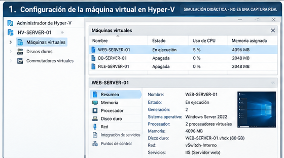

### Herramientas que usaremos para la migración

Las siguientes herramientas permiten realizar el proceso de forma controlada y comprobar su funcionamiento antes de completar la migración definitiva.

| Herramienta | Descripción | Enlaces |
| --- | --- | --- |
| Microsoft Hyper-V | Es la plataforma de virtualización donde se encuentra actualmente nuestra máquina virtual. Nos permite administrar sus recursos, comprobar su configuración y consultar su estado. | [Instalación y configuración](https://learn.microsoft.com/es-es/windows-server/virtualization/hyper-v/get-started/install-hyper-v?utm_source=chatgpt.com) |
| Administrador de Hyper-V | Permite administrar las máquinas virtuales y sus recursos, comprobar su configuración y consultar su estado. | [Herramientas de administración](https://learn.microsoft.com/es-es/windows-server/virtualization/hyper-v/manage/remotely-manage-hyper-v-hosts?utm_source=chatgpt.com) |
| Microsoft Azure | Es el proveedor de servicios en la nube donde queremos alojar la máquina virtual. Desde su portal podemos configurar los recursos necesarios, como máquinas virtuales, discos y redes. | [Acceder al portal](https://portal.azure.com/?utm_source=chatgpt.com) |
| Azure Migrate | Es la herramienta de Microsoft que facilita la migración de servidores a Azure. Permite descubrir y evaluar equipos, preparar la migración y realizar el traslado de las máquinas virtuales. | [Detección de máquinas Hyper-V](https://learn.microsoft.com/es-es/azure/migrate/tutorial-discover-hyper-v?utm_source=chatgpt.com) |
| Azure Migrate — migración | Permite preparar y realizar el traslado de las máquinas virtuales a Azure. | [Manual de migración paso a paso](https://learn.microsoft.com/es-es/azure/migrate/tutorial-migrate-hyper-v?utm_source=chatgpt.com) |
| Azure Site Recovery Provider | Es un componente que se instala en el servidor Hyper-V. Se encarga de colaborar en la replicación de los datos de las máquinas virtuales hacia Azure. | [Descarga, instalación y registro](https://learn.microsoft.com/es-es/azure/migrate/tutorial-migrate-hyper-v?utm_source=chatgpt.com) |
| Recovery Services Agent | Es otro componente necesario para el procedimiento de migración de Hyper-V. Se instala junto con el proveedor de replicación para permitir la comunicación y transferencia de datos. | [Descarga, instalación y registro](https://learn.microsoft.com/es-es/azure/migrate/tutorial-migrate-hyper-v?utm_source=chatgpt.com) |

## 2. Procedimiento de migración

Seguiremos las siguientes fases:

**Nota sobre las imágenes:** las ilustraciones identificadas como «simulación didáctica» son imágenes ficticias utilizadas para explicar el proceso, como se indica en la bibliografía.

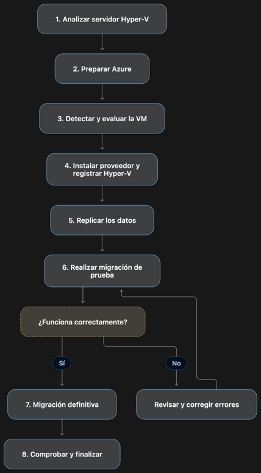

### Fase 1. Crear un proyecto en Azure Migrate

Accedemos al [portal de Microsoft Azure](https://portal.azure.com/) y buscamos el servicio [Azure Migrate](https://azure.microsoft.com/es-es/products/azure-migrate/).

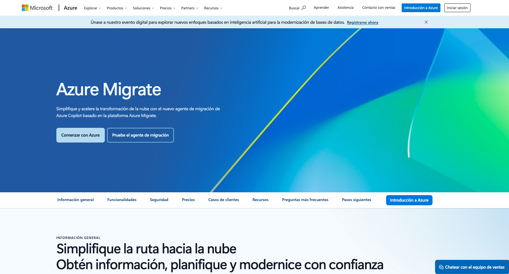

Desde esta herramienta creamos un proyecto, indicando la suscripción, el grupo de recursos y la ubicación donde queremos organizar la migración.

El proyecto nos permitirá centralizar la información de los servidores que vamos a trasladar y realizar un seguimiento del proceso.

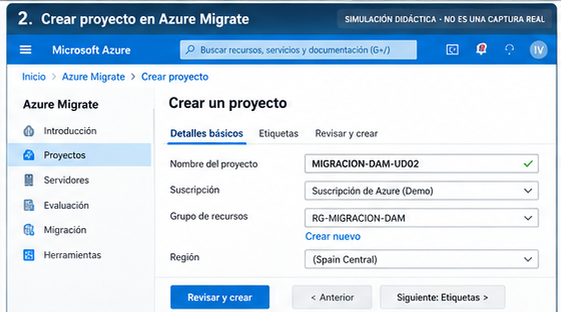

### Fase 2. Detectar y evaluar la máquina virtual

Antes de migrar, conviene utilizar la opción de detección y evaluación de Azure Migrate.

Para ello, Microsoft ofrece un dispositivo de detección que puede desplegarse en el entorno Hyper-V.

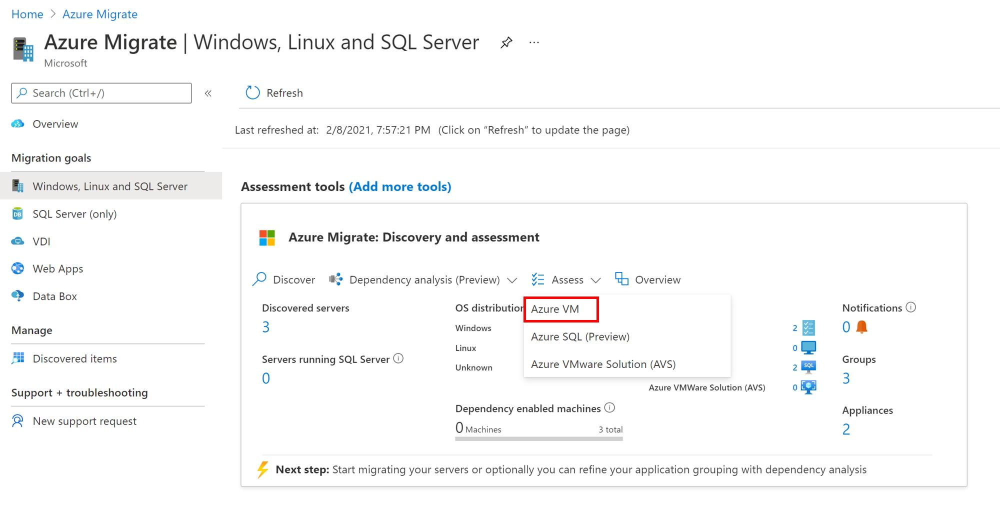

Configuración de la detección de servidores Hyper-V. [Referencia de la captura](https://learn.microsoft.com/es-es/azure/migrate/tutorial-discover-hyper-v?utm_source=chatgpt.com).

Esta herramienta recopila información sobre las máquinas virtuales, como los recursos que utilizan y sus características.

Con estos datos podemos evaluar si nuestra máquina es compatible con Azure y conocer una estimación de los recursos y costes que necesitaríamos.

De esta forma, evitamos comenzar una migración sin comprobar antes si el servidor podrá funcionar correctamente en el destino.

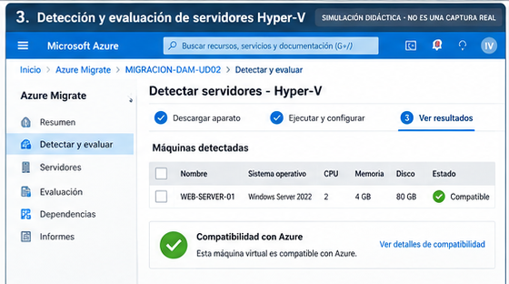

### Fase 3. Preparar la replicación

Una vez comprobada la compatibilidad, comenzamos a preparar la migración.

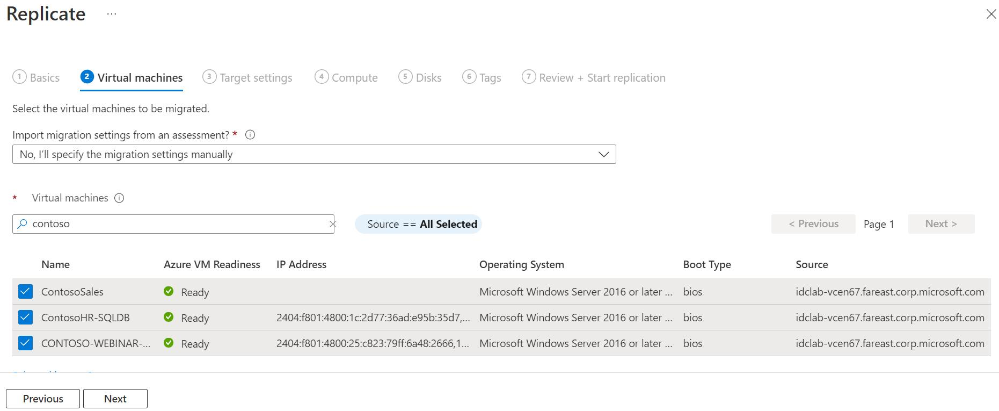

Selección del servidor y los recursos de destino. [Referencia de la captura](https://learn.microsoft.com/es-es/azure/migrate/tutorial-migrate-hyper-v?utm_source=chatgpt.com).

En Azure Migrate seleccionamos la opción para migrar servidores o máquinas virtuales y elegimos Microsoft Hyper-V como origen.

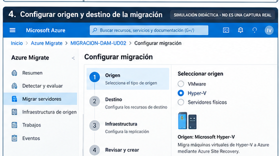

A continuación, seleccionamos la región de Azure donde queremos alojar nuestra máquina.

Microsoft proporciona un instalador del proveedor de replicación y una clave de registro.

Debemos instalar y registrar este proveedor en el servidor Hyper-V. También se instala el agente de Recovery Services necesario para el proceso.

Estos componentes permiten conectar nuestro entorno local con Azure y preparar la transferencia de los datos.

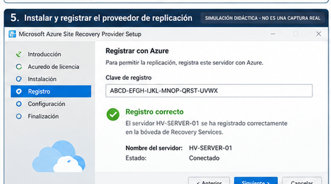

### Fase 4. Configurar e iniciar la replicación

Desde Azure Migrate seleccionamos la máquina virtual WEB-SERVER-01 y configuramos los recursos de destino.

Debemos indicar aspectos como:

- La suscripción y el grupo de recursos.
- La región de Azure.
- El tamaño de la futura máquina virtual.
- El almacenamiento de los discos.
- La red virtual donde se conectará.

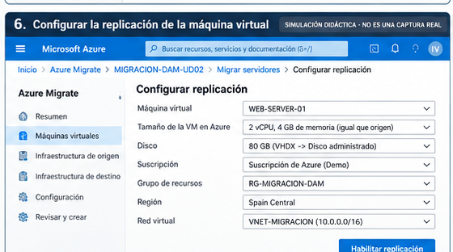

Después iniciamos la replicación.

Durante este proceso se envían los datos de la máquina virtual a Azure. Primero se realiza una copia inicial y, posteriormente, se sincronizan los cambios que se producen en el origen.

Así podemos preparar la máquina de destino sin tener que detener inmediatamente el servidor local.

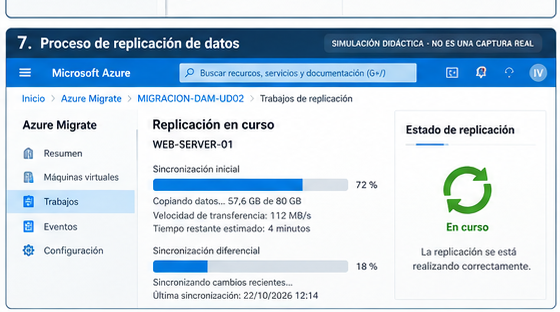

### Fase 5. Realizar una migración de prueba

Antes de trasladar definitivamente el servidor, Microsoft recomienda realizar una migración de prueba.

Configuración de la red de destino para la migración de prueba. [Referencia de la captura](https://learn.microsoft.com/es-es/azure/migrate/tutorial-migrate-hyper-v?utm_source=chatgpt.com).

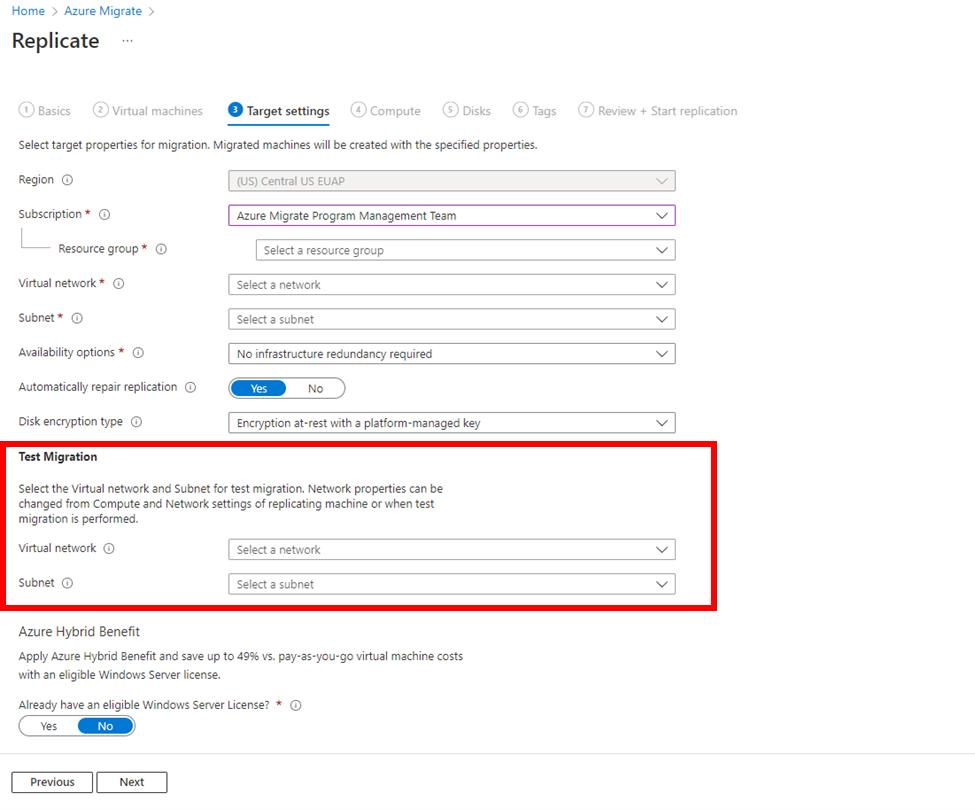

Esta opción permite crear una máquina virtual de prueba en Azure utilizando los datos replicados, sin interrumpir el funcionamiento de la máquina original.

En nuestro ejemplo comprobaríamos que:

- Windows Server arranca correctamente.
- El servidor web IIS funciona.
- Los archivos de la página web están disponibles.
- La configuración de red permite acceder al servicio.
- No aparecen errores importantes.

Es recomendable realizar la prueba en una red virtual separada de la utilizada en producción, para evitar posibles conflictos.

Si encontramos algún problema, debemos solucionarlo antes de continuar.

Una vez finalizada la comprobación, podemos limpiar los recursos utilizados para la prueba.

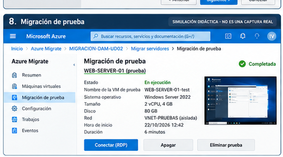

### Fase 6. Realizar la migración definitiva

Cuando comprobamos que la máquina funciona correctamente, podemos realizar la migración definitiva.

Desde Azure Migrate seleccionamos la máquina y utilizamos la opción Migrar.

Para evitar la pérdida de datos, podemos elegir una migración planificada que apague la máquina original y realice una última sincronización de los cambios pendientes.

Azure utilizará los discos replicados para crear la máquina virtual definitiva en la nube.

Durante esta operación puede producirse una interrupción temporal del servicio, por lo que conviene realizarla en un horario que afecte lo menos posible a los usuarios.

### Fase 7. Comprobar el funcionamiento

Una vez finalizada la migración, debemos comprobar que la máquina virtual funciona correctamente en Azure.

Para nuestro servidor web, realizaríamos las siguientes comprobaciones:

- Verificar que la máquina virtual está encendida.
- Comprobar que Windows Server funciona correctamente.
- Revisar que IIS se está ejecutando.
- Acceder a la página web desde un navegador.
- Comprobar la configuración de red y los permisos de acceso.
- Revisar posibles errores y el estado de los servicios.

Si el resultado es correcto, podremos dirigir el tráfico de la página web al servidor alojado en Azure.

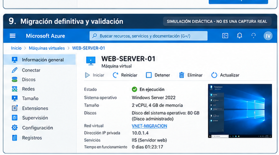

Finalmente, completamos la migración desde Azure Migrate, detenemos la replicación y actualizamos la documentación de la empresa.

También conviene configurar nuevas copias de seguridad para proteger la máquina virtual en su nueva ubicación.

## 3. Posibles problemas durante la migración

Aunque Azure Migrate facilita mucho el proceso, antes de realizar una migración debemos tener en cuenta algunos posibles problemas. Por ejemplo, puede que el sistema operativo no sea compatible, que la máquina necesite más recursos de los previstos o que existan problemas de comunicación entre el servidor local y Azure.

También debemos comprobar las aplicaciones instaladas, ya que algunos servicios pueden necesitar cambios de configuración para funcionar correctamente en la nueva red.

Otro aspecto importante es el coste. Aunque dejamos de mantener parte de la infraestructura física, los recursos que utilizamos en Azure tienen un coste que dependerá de su configuración y consumo.

Por estos motivos, considero importante realizar una evaluación previa y una migración de prueba antes de trasladar definitivamente un servidor.

## 4. Conclusión y valoración personal

Después de analizar el procedimiento, entiendo que migrar una máquina virtual a la nube no consiste únicamente en copiar sus archivos de un servidor a otro.

Es necesario comprobar la compatibilidad, preparar el nuevo entorno, replicar los datos y verificar que todos los servicios siguen funcionando.

La principal ventaja que encuentro es que una empresa puede reducir su dependencia de los equipos físicos y disponer de recursos que puede ampliar o modificar según sus necesidades.

También creo que hay que tener en cuenta que utilizar la nube no significa eliminar todos los problemas de mantenimiento o seguridad. La empresa sigue siendo responsable de administrar correctamente sus máquinas virtuales y proteger su información.

En definitiva, la migración V2C puede ser una buena solución para modernizar una infraestructura, siempre que se planifique correctamente y se estudien sus costes y necesidades.

## 5. Bibliografía

Las siguientes fuentes se han consultado para elaborar el documento.

| Fuente | Información utilizada |
| --- | --- |
| [Microsoft Learn — Detección de Hyper-V](https://learn.microsoft.com/es-es/azure/migrate/tutorial-discover-hyper-v?view=migrate&utm_source=chatgpt.com) | Configuración inicial y detección |
| [Microsoft Learn — Evaluación de Hyper-V](https://learn.microsoft.com/azure/migrate/tutorial-assess-hyper-v?utm_source=chatgpt.com) | Compatibilidad, recursos y costes |
| [Microsoft Learn — Migración de Hyper-V](https://learn.microsoft.com/es-es/azure/migrate/tutorial-migrate-hyper-v?utm_source=chatgpt.com) | Replicación, prueba y migración definitiva |
| [Microsoft Learn — Documentación de Azure Migrate](https://learn.microsoft.com/es-es/azure/migrate/?utm_source=chatgpt.com) | Información general y herramientas |
| ChatGPT | Imágenes ficticias, guía, explicación de conceptos y ayuda en la obtención de información. |
| Apuntes CESUR — UD02, Hardware Cloud | Conceptos de virtualización y V2C, especialmente páginas 38–42 |
