# Tarea 02 — Instalación y comparativa con IntelliJ IDEA

**Asignatura:** Entornos de Desarrollo · DAM  
**Alumno:** Iván Villarrubia Moreno

## Índice

- [Enunciado](#enunciado)
- [Introducción](#introducción)
- [1. Instalación](#1-instalación)
- [2. Comparativa entre IntelliJ IDEA y Eclipse IDE](#2-comparativa-entre-intellij-idea-y-eclipse-ide)
- [3. Probando IntelliJ IDEA](#3-probando-intellij-idea)
- [4. Conclusión](#4-conclusión)
- [5. Bibliografía](#5-bibliografía)

## Enunciado

Vuestra empresa está estudiando diferentes herramientas de desarrollo para llevar a cabo un proyecto.

**Cuestiones a resolver**

Instala el entorno de desarrollo IntelliJ y documenta todo el proceso, poniendo en valor aquellas ventajas e inconvenientes que puedes encontrar con respecto a otros entornos de desarrollo que has podido probar.

## Introducción

En esta tarea vamos a instalar y conocer IntelliJ IDEA, un entorno de desarrollo utilizado principalmente para programar en Java.

Después de la instalación, compararemos sus características con Eclipse IDE, que ya hemos utilizado en la asignatura de Programación.

También realizaremos una pequeña prueba para comprobar su funcionamiento y conocer las diferencias entre ambos programas.

## 1. Instalación
  
Para instalar IntelliJ IDEA, he accedido a la web oficial de JetBrains y he seguido los pasos para descargar e instalar el programa en macOS:

### 1.1. Acceso a la web oficial de JetBrains en la sección de IntelliJ IDEA: https://www.jetbrains.com/es-es/idea/

### 1.2. . Acceso a la opción de descarga del IDE: https://www.jetbrains.com/es-es/idea/download/?section=mac

### 1.3. Confirmación de la descarga del programa (app): <https://www.jetbrains.com/es-es/idea/download/download-thanks.html?platform=macM1>  
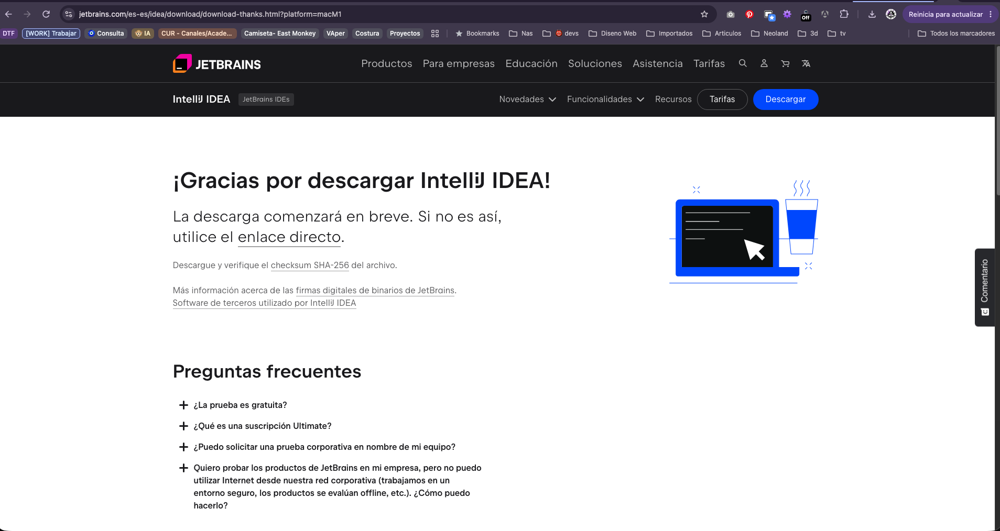

### 1.4. Copia de la aplicación en la carpeta Aplicaciones (instalación básica de macOS):

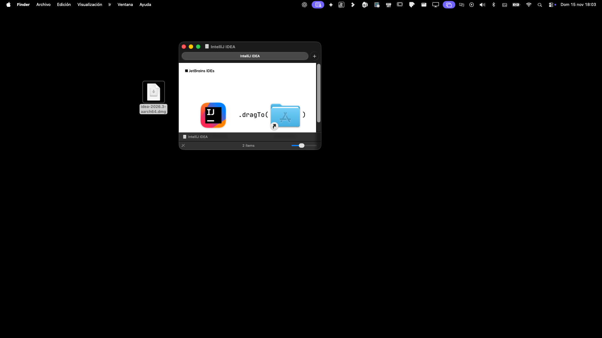

### 1.5. Proceso de instalación y autoconfiguración:

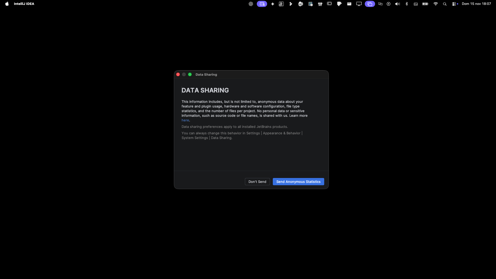

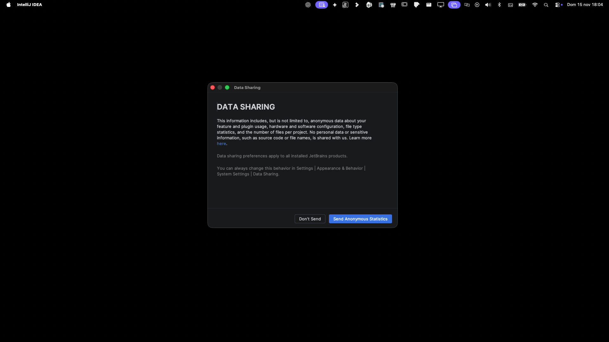

### 1.6. . Instalación completada:

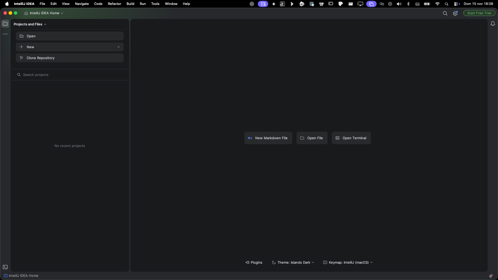

La descarga e instalación de IntelliJ IDEA no ha sido complicada. El proceso ha sido sencillo, guiado y sin problemas.

Personalmente, me ha resultado mucho más fácil instalar IntelliJ IDEA que Eclipse.

## 2. Comparativa entre IntelliJ IDEA y Eclipse IDE

| Característica | IntelliJ IDEA (gratuito) | Eclipse IDE |
| --- | --- | --- |
| Desarrollador | JetBrains | Eclipse Foundation |
| Licencia y precio | Funciones principales gratuitas. Herramientas avanzadas con suscripción Ultimate. | Gratuito y de código abierto. |
| Lenguaje principal | Java y Kotlin. | Java. |
| Otros lenguajes | Kotlin, XML, SQL y otros mediante funciones disponibles y plugins. | C, C++, PHP, JavaScript, HTML, CSS, XML y otros, dependiendo del paquete y plugins. |
| Interfaz | Más moderna y simplificada. | Más clásica, con bastantes paneles y opciones. |
| Facilidad de uso | Bastante intuitivo para empezar a programar Java. | Puede costar algo más acostumbrarse a la distribución de ventanas. |
| Editor de código | Muy completo, con autocompletado y sugerencias mientras escribimos. | También incluye autocompletado, detección de errores y ayuda para escribir código. |
| Detección de errores | Muestra errores y posibles mejoras directamente en el editor. | Detecta errores y advertencias durante la programación. |
| Refactorización | Muy completa y fácil de utilizar. | También tiene herramientas de refactorización para Java. |
| Depuración (Debug) | Permite poner puntos de interrupción, revisar variables y ejecutar paso a paso. | Ofrece prácticamente las mismas funciones de depuración. |
| Plugins | JetBrains Marketplace. Muchos vienen incluidos. | Eclipse Marketplace y repositorios de actualización. Muy ampliable. |
| Git y GitHub | Integración con Git, historial, ramas, commits, push, pull y GitHub. | Integración mediante EGit, que suele venir incluida en los paquetes Java. |
| Personalización | Temas, colores, fuentes, atajos y organización de ventanas. | Temas, perspectivas, vistas, paneles, atajos y plugins. |
| Actualizaciones | Desde el propio programa o mediante JetBrains Toolbox. | Desde Help → Check for Updates. |
| Maven y Gradle | Soporte integrado para trabajar con proyectos y dependencias. | También ofrece soporte para ambos sistemas. |
| Consumo de recursos | Puede utilizar bastante memoria, especialmente en proyectos grandes. | También puede consumir bastante memoria, sobre todo con muchos plugins. |
| Limitaciones | Algunas funciones avanzadas requieren una suscripción. | Algunas funciones requieren instalar o configurar plugins adicionales. |
| Sistemas operativos | Windows, macOS y Linux. | Windows, macOS y Linux. |

### Comparación visual de las interfaces

**IntelliJ IDEA**

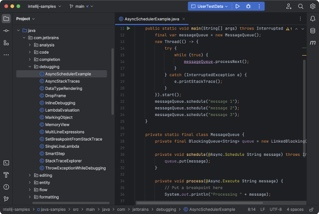

**Eclipse IDE**

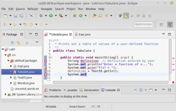

###  Ventajas e inconvenientes:

| **IDE**           | **Ventajas**                                                                                                                       | **Inconvenientes**                                                                                                                        |
|-------------------|------------------------------------------------------------------------------------------------------------------------------------|-------------------------------------------------------------------------------------------------------------------------------------------|
| **IntelliJ IDEA** | Interfaz moderna, buen autocompletado, herramientas inteligentes para Java, integración con Git y configuración bastante sencilla. | Algunas funciones son de pago. Puede consumir bastantes recursos y tiene muchas opciones que al principio no conocemos.                   |
| **Eclipse IDE**   | Totalmente gratuito, muy ampliable, compatible con distintos lenguajes y con una comunidad de usuarios muy amplia.                 | Interfaz algo menos intuitiva, configuración que puede resultar más compleja y posible pérdida de rendimiento al instalar muchos plugins. |

**Fuentes:** documentación oficial de JetBrains, Eclipse Foundation y manual de la unidad didáctica 2.*

### Número de usuarios y popularidad:

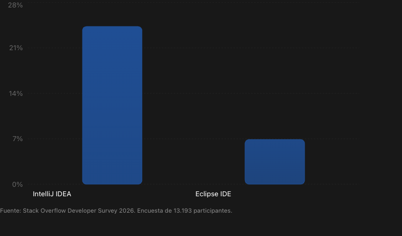

| **IDE**           | **Personas que lo utilizan en la encuesta** | **Porcentaje** |
|-------------------|---------------------------------------------|----------------|
| **IntelliJ IDEA** | 3.201                                       | 24,3 %         |
| **Eclipse IDE**   | 910                                         | 6,9 %          |

Para comparar su popularidad he utilizado los resultados de la encuesta de desarrolladores de Stack Overflow: Uso de IntelliJ IDEA y Eclipse IDE en 2026.  

*Fuente: Stack Overflow Developer Survey 2026. Encuesta de 13.193 participantes.*

## 3. Probando IntelliJ IDEA

En la asignatura de Programación hemos trabajado con Eclipse para desarrollar programas en Java.

Ahora vamos a probar IntelliJ IDEA con un programa sencillo, para conocer su funcionamiento y poder comparar ambos entornos desde la práctica.

Pantalla de inicio de IntelliJ IDEA:

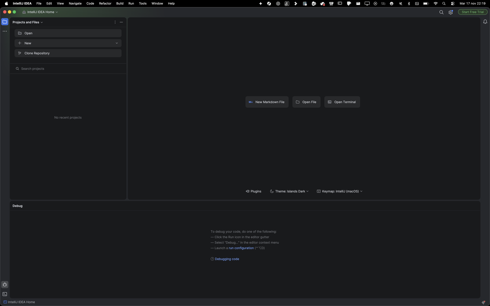

Creación de un nuevo proyecto Java:

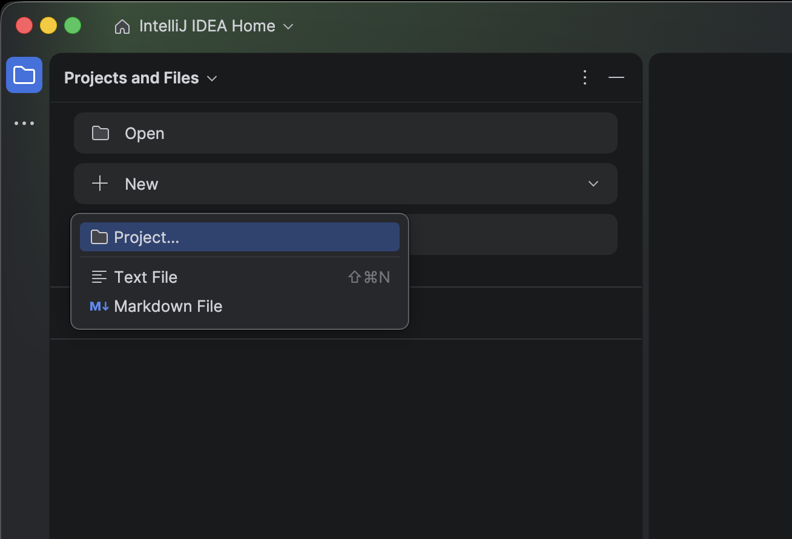

Configuración del proyecto:

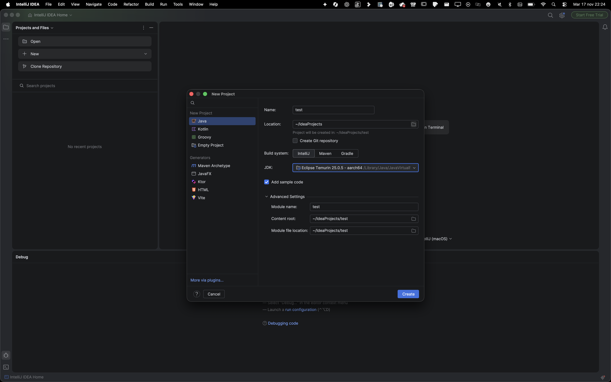

Código Java y ejecución del programa:  
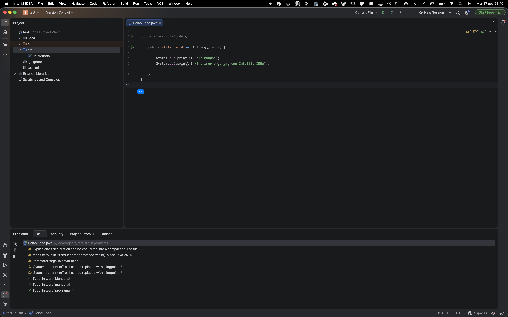

Para realizar la prueba, he creado un proyecto Java y he escrito un programa sencillo que muestra un mensaje en la consola.

Al principio tuve un error porque el nombre de la clase no coincidía con el del archivo. IntelliJ detectó el problema y me permitió localizarlo y corregirlo.

Esta prueba me ha servido para conocer cómo se crean los proyectos y cómo nos ayuda el programa a detectar errores mientras escribimos código.

## 4. Conclusión

Después de comparar los dos entornos, creo que tanto IntelliJ IDEA como Eclipse son buenas opciones para programar en Java.

IntelliJ IDEA me parece más cómodo por su interfaz y por las ayudas que ofrece cuando estamos escribiendo código. Además, tiene bastantes herramientas integradas, por lo que no necesitamos configurar tantas cosas desde el principio.

Eclipse también es una buena alternativa, sobre todo porque es completamente gratuito y permite instalar muchos complementos. Sin embargo, su interfaz me resulta algo menos intuitiva y puede llevar más tiempo acostumbrarse a todas sus opciones.

Si tuviera que elegir entre los dos, me quedaría con IntelliJ IDEA.

## 5. Bibliografía

1.  JetBrains. IntelliJ IDEA: página oficial y descarga.  
    https://www.jetbrains.com/es-es/idea/

2.  JetBrains. Documentación de IntelliJ IDEA y sus funcionalidades.  
    https://www.jetbrains.com/help/idea/

3.  JetBrains. Marketplace de plugins y extensiones.  
    https://plugins.jetbrains.com/

4.  JetBrains. Información sobre la versión unificada de IntelliJ IDEA.  
    https://www.jetbrains.com/help/idea/IntelliJ-idea-single-distribution.html

5.  Eclipse Foundation. Web oficial de Eclipse IDE.  
    https://www.eclipse.org/

6.  Eclipse Foundation. Versiones y paquetes disponibles de Eclipse.  
    https://www.eclipse.org/downloads/packages/

7.  Eclipse Foundation. Documentación de integración con Git (EGit)  
    https://help.eclipse.org/latest/topic/org.eclipse.egit.doc/help/EGit/User_Guide/Tasks.html

8.  Stack Overflow. Developer Survey 2026, herramientas de desarrollo más utilizadas.  
    https://survey.stackoverflow.co/2026/technology/data/dev-ide

9.  JetBrains. The State of Java 2025, encuesta sobre el uso de herramientas Java.  
    https://lp.jetbrains.com/es-es/the-state-of-java-2025/

10. CESUR. Unidad Didáctica 2: Entornos de Desarrollo. Material de estudio del módulo de Entornos de Desarrollo del ciclo formativo de DAM.

11. OpenAI. ChatGPT. Utilizado como apoyo para organizar la información, comparar características y redactar algunos apartados.
