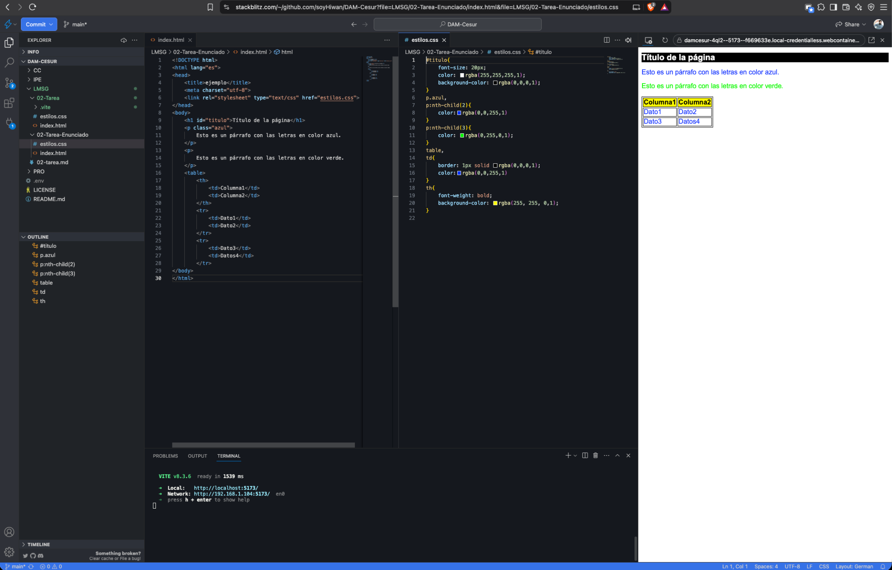
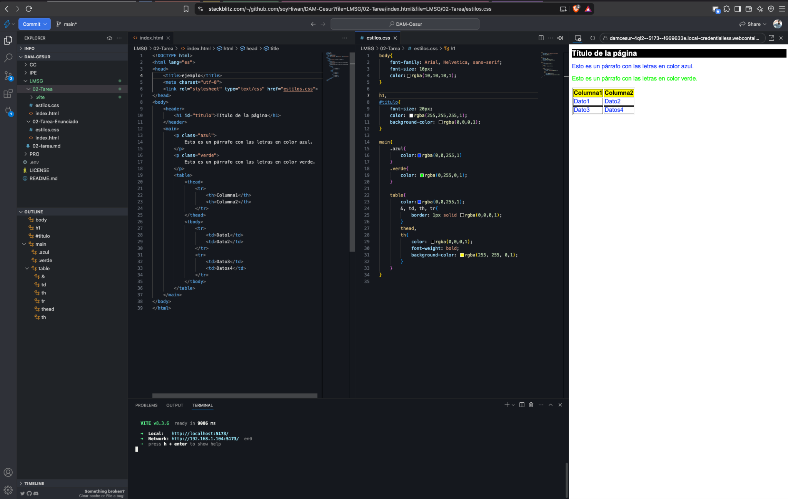

# Tarea 02 · Uso de selectores CSS

**Iván Villarrubia Moreno** · DAM · Lenguajes de Marcas

## Índice

- [Enunciado](#enunciado)
- [Introducción](#introducción)
- [Resolución de la tarea](#resolución-de-la-tarea)
- [Propuesta de mejora](#propuesta-de-mejora)
- [Conclusiones](#conclusiones)
- [Bibliografía y recursos](#bibliografía-y-recursos)

## Enunciado  
En tu tarea diaria como profesional en el departamento de informática de una empresa de desarrollo web, recibirás encargos, por parte de clientes, para modificar páginas web según sus demandas y necesidades.

Proporcionándote te facilita el siguiente código HTML:

```html
<!DOCTYPE html>
<html lang="es">
<head>
    <title>ejemplo</title>
    <meta charset="utf-8">
    <link rel="stylesheet" type="text/css" href="estilos.css">
</head>
<body>
    <h1 id="titulo">Título de la página</h1>
    <p class="azul">
        Esto es un párrafo con las letras en color azul.
    </p>
    <p>
        Esto es un párrafo con las letras en color verde.
    </p>
    <table>
    	<th>
            <td>Columna1</td>
            <td>Columna2</td>
        </th>
        <tr>
            <td>Dato1</td>
            <td>Dato2</td>
        </tr>
        <tr>
            <td>Dato3</td>
            <td>Datos4</td>
        </tr>
</body>
```

## Introducción

Para realizar este ejercicio he utilizado StackBlitz, conectado a mi repositorio de GitHub, donde estoy organizando los ejercicios del curso por asignaturas para facilitar su consulta.

En la solución principal he conservado el HTML facilitado y he aplicado los estilos mediante una hoja CSS externa, tal como pide el enunciado:  
<https://github.com/soyHiwan/DAM-Cesur/tree/main/LMSG/02-Tarea-Enunciado>

Al revisar el código, observé que faltaba la etiqueta de cierre \</table\> y que el encabezado de la tabla estaba mal estructurado. Aunque el navegador puede mostrar la tabla, el marcado sigue siendo incorrecto.

Por eso preparé una versión complementaria con sus propios archivos HTML y CSS. En ella he corregido el cierre de la tabla y reorganizado las filas y las celdas para distinguir el encabezado de los datos. Más adelante explico estos cambios:  
<https://github.com/soyHiwan/DAM-Cesur/tree/main/LMSG/02-Tarea>  
<https://github.com/soyHiwan/DAM-Cesur/tree/main/LMSG/02-Tarea-Enunciado>

## Resolución de la tarea

Para resolver el ejercicio, he conservado el HTML facilitado en el enunciado y he aplicado los estilos mediante el archivo estilos.css. Consultar el código de la solución en StackBlitz; <https://stackblitz.com/~/github.com/soyHiwan/DAM-Cesur?file=LMSG/02-Tarea-Enunciado/index.html&file=LMSG/02-Tarea-Enunciado/estilos.css>  
  
Para abrir la vista previa en StackBlitz, ejecuta estos comandos en la terminal del proyecto:

```bash
cd LMSG/02-Tarea-Enunciado
npx --yes vite --host 0.0.0.0
```

Figura 1. Vista previa del ejercicio en StackBlitz.



#### Código CSS de la solución

```css
#titulo{
    font-size: 20px;
    color: rgba(255,255,255,1);
    background-color: rgba(0,0,0,1);
}
p.azul,
p:nth-child(2){
    color:rgba(0,0,255,1)
}
p.azul + p,
p:nth-child(3){
    color: rgba(0,255,0,1);
}
table,
td{
    border: 1px solid rgba(0,0,0,1); 
    color:rgba(0,0,255,1)
}
th{
    font-weight: bold;
    background-color: rgba(255, 255, 0,1);
}
```

A la hora de crear el css he sido muy estrictos con las propiedades, en vez de solo hacer la clase azul, por ejemplo, al aplicarse a un párrafo \<p\>, he marcado que solo se cumpla esa condición cuando \<p\> tenga la clase azul. Azul no se puede aplicar a otro elemento que no sea un párrafo. También he añadido las opciones dependiendo de si la solicitud del enunciado podría ser vario, por ejemplo p.azul, p:nth-child(2).

## Propuesta de mejora

En esta versión he aplicado las siguientes mejoras:

- cambios en el **html.**

  - se cierra la tabla y separo el encabezado de los datos mediante \<thead\> y \<tbody\>.

  - en la tabla cada fila se define con \<tr\>. Utilizo \<th\> para los nombres de las columnas y \<td\> para los datos.

  - uso una estructura algo más semántica. agrupo el título en \<header\> y el contenido en \<main\>.

- **Css.**

  - al añadir la clase verde al segundo párrafo, puedo seleccionarlo sin depender de su posición.

  - agrupo las reglas de la tabla mediante anidación. El selector & permite incluir la propia tabla en la regla compartida del borde.

  - Los datos heredan el azul de la tabla y los encabezados se muestran en negro sobre amarillo.

Código en StackBlitz;  
[Ver propuesta en StackBlitz](https://stackblitz.com/~/github.com/soyHiwan/DAM-Cesur?file=LMSG/02-Tarea/index.html&file=LMSG/02-Tarea/estilos.css)  
  


### HTML de la propuesta

```html
<!DOCTYPE html>
<html lang="es">
<head>
    <title>ejemplo</title>
    <meta charset="utf-8">
    <link rel="stylesheet" type="text/css" href="estilos.css">
</head>
<body>
    <header>
        <h1 id="titulo">Título de la página</h1>
    </header>
    <main>
        <p class="azul">
            Esto es un párrafo con las letras en color azul.
        </p>
        <p class="verde">
            Esto es un párrafo con las letras en color verde.
        </p>
        <table>
            <thead>
                <tr>
                    <th>Columna1</th>
                    <th>Columna2</th>
                </tr>
            </thead>
            <tbody>
                <tr>
                    <td>Dato1</td>
                    <td>Dato2</td>
                </tr>
                <tr>
                    <td>Dato3</td>
                    <td>Datos4</td>
                </tr>
            </tbody>
        </table>
    </main>
</body>
</html>
```

### CSS de la propuesta

```css
body{
    font-family: Arial, Helvetica, sans-serif;
    font-size: 16px;
    color:rgba(10,10,10,1);
}

h1,
#titulo{
    font-size: 20px;
    color: rgba(255,255,255,1);
    background-color: rgba(0,0,0,1);
}

main{
    .azul{
        color:rgba(0,0,255,1)
    }
    .verde{
        color: rgba(0,255,0,1);
    }

    table{
        color:rgba(0,0,255,1);
        &, td, th, tr{
            border: 1px solid rgba(0,0,0,1); 
        }
        thead, 
        th{
            color: rgba(0,0,0,1);
            font-weight: bold;
            background-color: rgba(255, 255, 0,1);
        }    
    }
}
```

## Conclusiones

En la solución principal conservé el HTML del enunciado y apliqué los estilos desde una hoja CSS externa intentando que cumpla “todas” las posibilidades del enunciado.

El ejercicio me ha servido para practicar cómo seleccionar un elemento por su identificador, su clase o su posición dentro del documento.

Al revisar la tabla, comprobé que el navegador puede mostrarla aunque el marcado tenga errores.

En la propuesta de mejora cerré la tabla, e intenté que la estructura fuera más semántica separando los encabezados de los datos.

También añadí una clase al segundo párrafo para que su color se mantenga aunque cambie de posición.

## Bibliografía y recursos

- **CESUR.** *Lenguajes de Marcas y Sistemas de Gestión de la Información. Unidad didáctica 2*. Apartados sobre HTML, selectores CSS y validación de documentos web.

- **WHATWG.** *HTML Living Standard: Tabular data*. Referencia para la estructura de las tablas y el uso de \<table\>, \<tr\>, \<th\> y \<td\>. [Consultar el estándar HTML](https://html.spec.whatwg.org/multipage/tables.html).

- **W3C.** *Selectors Level 4*. Referencia para los selectores de tipo, clase e identificador, la pseudoclase :nth-child() y el combinador +. [Consultar la especificación de selectores CSS](https://www.w3.org/TR/selectors-4/).

- **W3C.** *Nu HTML Checker*. Herramienta para revisar el marcado HTML, incluida la estructura de la tabla. [Validar HTML](https://validator.w3.org/nu/).

- **W3C.** *CSS Validation Service*. Herramienta para comprobar la sintaxis de la hoja estilos.css. [Validar CSS](https://jigsaw.w3.org/css-validator/).

- **OpenAI.** *ChatGPT*. Herramienta de apoyo para resolver dudas sobre selectores CSS, revisar errores en la estructura de la tabla HTML y mejorar la redacción de la memoria. [ChatGPT](https://chatgpt.com/).

- **StackBlitz.** *Entorno de desarrollo en línea*. Utilizado para editar los archivos HTML y CSS y comprobar el resultado de ambas versiones del ejercicio en la vista previa. [StackBlitz](https://stackblitz.com/).

- **GitHub.** *Repositorio DAM-Cesur y GitHub Pages*. Utilizado para guardar el código de ambas versiones del ejercicio, gestionar sus cambios y publicar el resultado como página web.
