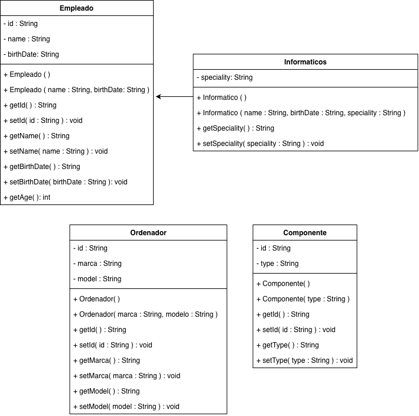
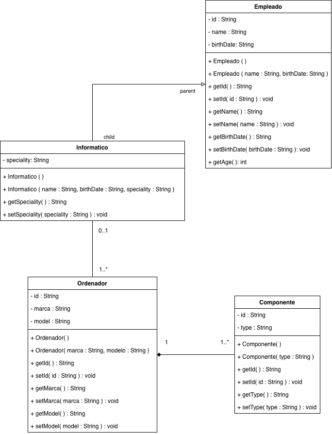
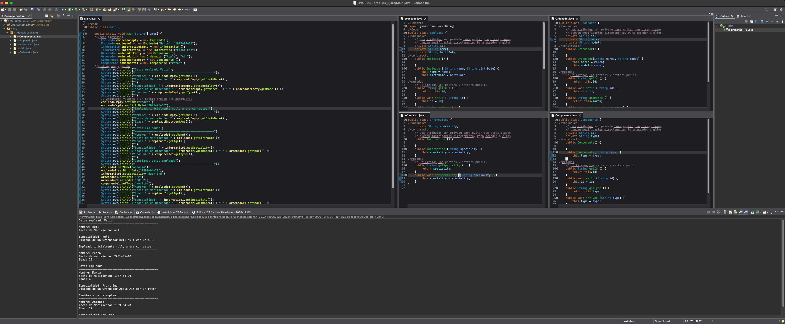

# Tarea 03 — Desarrollo de clases en Java

**Asignatura:** Programación · **Ciclo:** Desarrollo de Aplicaciones Multiplataforma (DAM)  
**Autor:** Iván Villarrubia Moreno · **Centro:** CESUR

> Trabajo realizado para la Unidad Didáctica 3: Programación Orientada a Objetos.

**Repositorio del proyecto:** [DAM-Cesur / PRO / 03-Tarea](https://github.com/soyHiwan/DAM-Cesur/tree/main/PRO/03-Tarea)

## Índice

- [Tarea 03 — Desarrollo de clases en Java](#tarea-03--desarrollo-de-clases-en-java)
	- [Índice](#índice)
	- [Enunciado](#enunciado)
	- [Introducción](#introducción)
	- [1. Representación de clases en UML](#1-representación-de-clases-en-uml)
	- [2. Relaciones entre clases UML](#2-relaciones-entre-clases-uml)
		- [2.1. Relaciones y multiplicidades](#21-relaciones-y-multiplicidades)
	- [3. Clases en código Java](#3-clases-en-código-java)
		- [3.1. Clase Empleado](#31-clase-empleado)
		- [3.2. Clase Informatico](#32-clase-informatico)
		- [3.3. Clase Ordenador](#33-clase-ordenador)
		- [3.4. Clase Componente](#34-clase-componente)
		- [3.5. Clase Main](#35-clase-main)
		- [3.6. Resultado de consola](#36-resultado-de-consola)
	- [Conclusión](#conclusión)
	- [Bibliografía y recursos utilizados](#bibliografía-y-recursos-utilizados)

## Enunciado

El jefe de proyecto de tu equipo de programación te ha pedido realizar una serie de clases que tienes que dejar listas en esta semana.

**1.** Crea las siguientes clases con notación **UML** y, posteriormente, en código **Java**, con sus correspondientes atributos, constructores con y sin parámetros y métodos getters y setters:

- Clase `Empleado` con tres atributos.
- Clase `Informatico` con un atributo propio (clase hija de `Empleado`).
- Clase `Ordenador` con tres atributos.
- Clase `Componente` con dos atributos.

**2.** Representa en UML también las relaciones entre clases:

- Un informático es un tipo de empleado (**herencia**).
- Un informático utiliza un ordenador (**asociación**). Un informático puede utilizar uno o varios ordenadores, y un ordenador puede estar asignado a un informático.
- Un ordenador está formado por diferentes componentes (RAM, disco duro, etc.), y queda a elección a cuántos ordenadores pertenece un componente.
- Explica brevemente por qué cada relación es de herencia, asociación o composición, en comentarios dentro del código.
- Indica la multiplicidad de cada relación siguiendo el formato del temario.

**3.** En código Java:

- Crea una clase ejecutable con el método `main()`.
- No implementes todavía las relaciones entre clases en Java; crea las clases, instancia objetos y utiliza constructores con y sin parámetros. Para los constructores sin parámetros, utiliza setters para asignar valores a los atributos.
- Indica la visibilidad (`public`, `private`, `protected`) y justifica tu elección mediante comentarios en el código.
- Muestra por pantalla los datos de cada objeto.

## Introducción

En esta tarea vamos a trabajar con la Programación Orientada a Objetos (POO), poniendo en práctica lo aprendido en la Unidad Didáctica 3.

Para ello, he creado cuatro clases: **Empleado, Informatico, Ordenador y Componente**, definiendo sus atributos, constructores y métodos para consultar y modificar sus datos.

Primero he utilizado **diagrams.net** para representar las clases en UML y establecer las relaciones entre ellas, como la herencia, la asociación y la composición.

Después he pasado a **Eclipse** para programar las clases en Java, crear distintos objetos y mostrar su información por consola.

Con este ejercicio he podido entender mejor cómo funcionan las clases y los objetos, para qué sirven los constructores y cómo se utilizan los métodos getters y setters. También me ha servido para familiarizarme un poco más con Java y ver cómo llevar un diseño UML a código.

## 1. Representación de clases en UML

Para realizar este ejercicio investigué inicialmente qué programa sería más interesante para crear el UML según los apuntes. Tuve dificultades con la instalación de **ArgoUML** y del plugin **Papyrus** para Eclipse en macOS. Desconozco si se debía a problemas de compatibilidad o a mi poca experiencia en este ámbito, así que finalmente lo realicé con **diagrams.net**, recomendado en la tarea.

Archivos del diagrama:

- [Diagrama editable (.drawio)](https://github.com/soyHiwan/DAM-Cesur/blob/main/PRO/03-Tarea/03-Tarea-03_1.drawio)
- [Imagen del diagrama (.png)](https://github.com/soyHiwan/DAM-Cesur/blob/main/PRO/03-Tarea/03-Tarea-03_1.drawio.png)

El siguiente diagrama representa las cuatro clases con sus atributos, constructores y métodos.



## 2. Relaciones entre clases UML

Para representar las relaciones también he utilizado **diagrams.net**.

- [Diagrama de relaciones editable (.drawio)](https://github.com/soyHiwan/DAM-Cesur/blob/main/PRO/03-Tarea/03-Tarea-03_2.drawio)
- [Imagen del diagrama de relaciones (.png)](https://github.com/soyHiwan/DAM-Cesur/blob/main/PRO/03-Tarea/03-Tarea-03_2.drawio.png)



### 2.1. Relaciones y multiplicidades

| Clase | Clase relacionada | Relación | Explicación |
|---|---|---|---|
| Empleado | Informatico | **Herencia** | Informatico es un tipo de empleado. Comparte sus características y añade la especialidad. |
| Informatico | Ordenador | **Asociación** | Informatico y Ordenador están relacionados, pero ambos pueden existir de manera independiente. |
| Ordenador | Componente | **Composición** | En el modelo propuesto, los componentes forman parte del ordenador y dependen de él. |

| Clase 1 | Clase 2 | Multiplicidad | Interpretación |
|---|---|---|---|
| Empleado | Informatico | Herencia | Relación de generalización. |
| Informatico | Empleado | Herencia | Relación de generalización hacia la clase padre. |
| Informatico | Ordenador | `1..*` | Un informático puede utilizar uno o varios ordenadores. |
| Ordenador | Informatico | `0..1` | Un ordenador puede estar asignado a un informático o a ninguno. |
| Ordenador | Componente | `1..*` | Un ordenador tiene uno o varios componentes. |
| Componente | Ordenador | `1` | Un componente pertenece a un único ordenador. |

## 3. Clases en código Java

A continuación se muestra el código Java de cada clase, siguiendo el orden del enunciado. Al final aparece `Main.java` y el resultado de la ejecución por consola.

Las variables de cada clase se han definido como **privadas**, ya que se debe acceder a sus valores desde la propia clase. Los métodos se han definido como **públicos** porque permiten consultar y modificar esos valores desde el exterior.

El código incluido a continuación corresponde a los archivos `.java` adjuntados con la entrega.

### 3.1. Clase Empleado

He añadido el método `getAge()` para calcular la edad a partir de la fecha de nacimiento y la fecha actual. Para hacerlo tuve que consultar información en Google y ChatGPT, porque son clases y métodos que todavía no habíamos estudiado.

```java
//imports
import java.time.LocalDate;
import java.time.Period;
//Code
public class Empleado {
//variables
	// Los atributos son private para evitar que otras clases
	// puedan modificarlos directamente. Para acceder a ellos
	private String id;
	private String name;
	private String birthDate;
//constructor
	public Empleado () { 
		
	}
	public Empleado ( String name, String birthDate) {
		this.name = name;
		this.birthDate = birthDate;
	}
//metodos
	// utilizamos los getters y setters public.
	public String getId ( ) {
		return this.id;
	}
	public void setId ( String id) {
		this.id = id;
	}
	public String getName ( ) {
		return this.name;
	}
	public void setName ( String name) {
		this.name = name;
	}
	public String getBirthDate ( ) {
		return this.birthDate;
	}
	public void setBirthDate ( String birthDate) {
		this.birthDate = birthDate;
	}
	public int getAge ( ) {
		LocalDate fechaNacimiento = LocalDate.parse(birthDate);
		LocalDate fechaActual = LocalDate.now();
		Period d = Period.between(fechaNacimiento, fechaActual);
		int age = d.getYears();
		return age;
	}
}
```

### 3.2. Clase Informatico

```java
public class Informatico {
//variables
	// Los atributos son private para evitar que otras clases
	// puedan modificarlos directamente. Para acceder a ellos
	private String speciality;
//constructor
	public Informatico () {
		
	}	
	public Informatico (String speciality) {
		this.speciality = speciality;
	}	
//metodos
	// utilizamos los getters y setters public.
	public String getSpeciality ( ) {
		return speciality;
	}
	public void setSpeciality ( String speciality ) {
		this.speciality = speciality; 
	}
}
```

### 3.3. Clase Ordenador

```java
public class Ordenador {
//variables
	// Los atributos son private para evitar que otras clases
	// puedan modificarlos directamente. Para acceder a ellos
	private String id;
	private String marca;
	private String model;
//constructor
	public Ordenador() {
		
	}
	public Ordenador(String marca, String model) {
		this.marca = marca;
		this.model = model;
	}
//metodos
	// utilizamos los getters y setters public.
	public String getId () {
		return this.id;
	}
	public void setId (String id) {
		this.id = id;
	}
	public String getMarca () {
		return this.marca;
	}
	public void setMarca (String marca) {
		this.marca = marca;
	}
	public String getModel () {
		return this.model;
	}
	public void setModel (String model) {
		this.model = model;
	}
}
```

### 3.4. Clase Componente

```java
public class Componente {
//variables
	// Los atributos son private para evitar que otras clases
	// puedan modificarlos directamente. Para acceder a ellos
	private String id;
	private String type;
//constructor
	public Componente() {
		
	}
	public Componente( String type) {
		this.type = type;
	}
//metodos
	// utilizamos los getters y setters public.
	public String getId () {
		return this.id;
	}
	public void setId (String id) {
		this.id = id;
	}
	public String getType () {
		return this.type;
	}
	public void setType (String type) {
		this.type = type;
	}
	
}
```

### 3.5. Clase Main

```java
// Relaciones representadas en UML:
// Herencia: Informatico es un tipo de Empleado.
// Asociacion: Informatico utiliza Ordenador; ambos son independientes.
// Composicion: Ordenador esta formado por componentes.
// Estas relaciones no se implementan en Java en esta unidad.
//code
public class Main {
	
	public static void main(String[] args) {
	//Crear elementos
		Empleado empleadoEmpty = new Empleado();
		Empleado empleado1 = new Empleado("Marta", "1977-04-20");
		Informatico informaticoEmpty = new Informatico ();
		Informatico informatico1 = new Informatico ("Front End");
		Ordenador ordenadorEmpty = new Ordenador ();
		Ordenador ordenador1 = new Ordenador ("Apple", "Air");
		Componente componenteEmpty = new Componente ();
		Componente componente1 = new Componente ("raton");
	//Mostrar por consola
		System.out.println("Datos empleado Vacio");
		System.out.println("-----------------------------------------------");
		System.out.println("Nombre: " + empleadoEmpty.getName());
		System.out.println("Fecha de Nacimiento: " + empleadoEmpty.getBirthDate());
		System.out.println("");
		System.out.println("Especialidad: " + informaticoEmpty.getSpeciality());
		System.out.print("Dispone de un Ordenador " + ordenadorEmpty.getMarca() + " " + ordenadorEmpty.getModel() );
		System.out.println(" con un " + componenteEmpty.getType());
		System.out.println("");
		// Asignamos valores a un objeto creado sin parametros
		empleadoEmpty.setName("Pedro");
		empleadoEmpty.setBirthDate("2001-05-10");
		System.out.println("Empleado inicialmente null, ahora con datos:");
		System.out.println("-----------------------------------------------");
		System.out.println("Nombre: " + empleadoEmpty.getName());
		System.out.println("Fecha de nacimiento: " + empleadoEmpty.getBirthDate());
		System.out.println("Edad: " + empleadoEmpty.getAge());
		System.out.println();
		System.out.println("Datos empleado");
		System.out.println("-----------------------------------------------");
		System.out.println("Nombre: " + empleado1.getName());
		System.out.println("Fecha de Nacimiento: " + empleado1.getBirthDate());
		System.out.println("Edad: " + empleado1.getAge());
		System.out.println("");
		System.out.println("Especialidad: " + informatico1.getSpeciality());
		System.out.print("Dispone de un Ordenador " + ordenador1.getMarca() + " " + ordenador1.getModel() );
		System.out.println(" con un " + componente1.getType());
		System.out.println("");
		System.out.println("Cambiamos datos empleado");
		System.out.println("-----------------------------------------------");
		empleado1.setName("Antonio");
		empleado1.setBirthDate("1999-04-20");
		informatico1.setSpeciality("Back End");
		ordenador1.setMarca("HP");
		ordenador1.setModel("30hd");
		componente1.setType("monitor");
		System.out.println("Nombre: " + empleado1.getName());
		System.out.println("Fecha de Nacimiento: " + empleado1.getBirthDate());
		System.out.println("Edad: " + empleado1.getAge());
		System.out.println("");
		System.out.println("Especialidad:" + informatico1.getSpeciality());
		System.out.print("Dispone de un Ordenador " + ordenador1.getMarca() + " " + ordenador1.getModel() );
		System.out.println(" con un " + componente1.getType());
	}

}
```

### 3.6. Resultado de consola

La prueba muestra primero objetos creados sin parámetros y con valores `null`. Después se asignan datos a uno de esos objetos mediante setters. Finalmente se presentan los valores de objetos creados con parámetros y sus modificaciones posteriores.

```text
Datos empleado Vacio
-----------------------------------------------
Nombre: null
Fecha de Nacimiento: null

Especialidad: null
Dispone de un Ordenador null null con un null

Empleado inicialmente null, ahora con datos:
-----------------------------------------------
Nombre: Pedro
Fecha de nacimiento: 2001-05-10
Edad: 25

Datos empleado
-----------------------------------------------
Nombre: Marta
Fecha de Nacimiento: 1977-04-20
Edad: 49

Especialidad: Front End
Dispone de un Ordenador Apple Air con un raton

Cambiamos datos empleado
-----------------------------------------------
Nombre: Antonio
Fecha de Nacimiento: 1999-04-20
Edad: 27

Especialidad:Back End
Dispone de un Ordenador HP 30hd con un monitor
```

La prueba permite comprobar cómo funciona un constructor vacío (`Clase()`) frente a otro que recibe valores (`Clase(valor, ...)`). Cuando creamos el objeto sin asignar valores, sus atributos `String` aparecen como `null`; mediante los setters podemos completarlos después.

**Captura de Eclipse:**



> Las edades mostradas corresponden a la ejecución recogida en el PDF. Al volver a ejecutar el programa, `getAge()` las calcula según la fecha actual.

## Conclusión

La elaboración de un mapa previo en UML de las clases ayuda mucho a la hora de plantear las clases, las relaciones entre ellas y sus características (variables y métodos).

Tras la elaboración, me ha costado mucho organizar los getters y setters, pero a lo largo del desarrollo de las demás clases he podido ir entendiendo su finalidad y necesidad.

El paso de UML a código Java también cuesta hasta entender cómo «traducir» entre una y otra forma de representar y escribir código; una vez entendido, mediante la práctica ha sido más fluido.

## Bibliografía y recursos utilizados

- **CESUR Formación** (2026). *Unidad Didáctica 3: Programación Orientada a Objetos*. Material didáctico del módulo de Programación de DAM.
- **diagrams.net (draw.io).** Herramienta utilizada para diseñar los diagramas UML, las relaciones y sus multiplicidades. https://app.diagrams.net/
- **Eclipse Foundation.** *Eclipse IDE for Java Developers*. Utilizado para escribir, compilar y ejecutar las clases Java. https://www.eclipse.org/
- **Oracle.** *Java Documentation*. Referencia sobre clases, objetos, constructores, métodos y tipos de datos Java. https://docs.oracle.com/en/java/
- **GitHub.** Plataforma utilizada para guardar y organizar los archivos del proyecto. https://github.com/soyHiwan/DAM-Cesur
- **ChatGPT (OpenAI).** Apoyo para comprender conceptos de POO, resolver dudas sobre UML y Java y consultar `LocalDate` y `Period`.
- **Microsoft Copilot.** Herramienta de apoyo para la revisión ortográfica y gramatical del documento.
